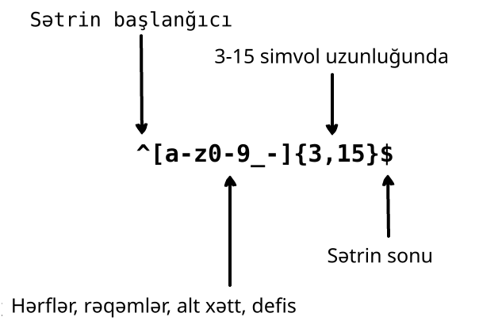

     
    

## Tərcümələr:

* [English](../README.md)
* [German](../translations/README-de.md)
* [Español](../translations/README-es.md)
* [Français](../translations/README-fr.md)
* [Português do Brasil](../translations/README-pt_BR.md)
* [中文版](../translations/README-cn.md)
* [日本語](../translations/README-ja.md)
* [한국어](../translations/README-ko.md)
* [Turkish](../translations/README-tr.md)
* [Greek](../translations/README-gr.md)
* [Magyar](../translations/README-hu.md)
* [Polish](../translations/README-pl.md)
* [Русский](../translations/README-ru.md)
* [Tiếng Việt](../translations/README-vn.md)
* [Bahasa Indonesia](../translations/README-id.md)
* [فارسی](../translations/README-fa.md)
* [עברית](../translations/README-he.md)
* [Azərbaycanca](../translations/README-az.md)

## Regex nədir?

    

> Regex (regular expression) mətndə müəyyən bir şablonu tapmaq üçün istifadə olunan simvollar qrupudur.

Regex verilmiş string-ə soldan sağa doğru tətbiq olunan bir şablondur.
Regex-lər string daxilində mətni dəyişdirmək, formaları validate etmək,
şablona uyğunluğa görə string-dən substring çıxarmaq və daha bir çox iş üçün
istifadə olunur. "Regular expression" ifadəsi uzun olduğu üçün adətən onun
qısaldılmış forması olan "regex" və ya "regexp" istifadə olunur.

Təsəvvür edin ki, bir application yazırsınız və istifadəçinin username seçməsi
üçün qaydalar təyin etmək istəyirsiniz. Username-də hərflərin, rəqəmlərin, alt
xəttin və defisin olmasına icazə vermək istəyirik. Həmçinin username-in pis
görünməməsi üçün simvolların sayını məhdudlaşdırmaq istəyirik. Username-i
validate etmək üçün aşağıdakı regex-dən istifadə edə bilərik:

  

  

Yuxarıdakı regex `john_doe`, `jo-hn_doe` və `john12_as` string-lərini qəbul edir.
`Jo` isə match olmur, çünki bu string-də böyük hərf var və o, həm də çox qısadır.

## Mündəricat

- [Əsas matcher-lər](#1-əsas-matcher-lər)
- [Meta character-lər](#2-meta-character-lər)
  - [Nöqtə](#21-nöqtə)
  - [Character set-lər](#22-character-set-lər)
    - [Negated character set-lər](#221-negated-character-set-lər)
  - [Təkrarlar](#23-təkrarlar)
    - [Ulduz](#231-ulduz)
    - [Üstəgəl](#232-üstəgəl)
    - [Sual işarəsi](#233-sual-işarəsi)
  - [Fiqurlu mötərizələr](#24-fiqurlu-mötərizələr)
  - [Capturing group-lar](#25-capturing-group-lar)
    - [Non-capturing group-lar](#251-non-capturing-group-lar)
  - [Alternation](#26-alternation)
  - [Xüsusi simvolları escape etmək](#27-xüsusi-simvolları-escape-etmək)
  - [Anchor-lar](#28-anchor-lar)
    - [Caret](#281-caret)
    - [Dollar işarəsi](#282-dollar-işarəsi)
- [Shorthand character set-lər](#3-shorthand-character-set-lər)
- [Lookaround-lar](#4-lookaround-lar)
  - [Positive lookahead](#41-positive-lookahead)
  - [Negative lookahead](#42-negative-lookahead)
  - [Positive lookbehind](#43-positive-lookbehind)
  - [Negative lookbehind](#44-negative-lookbehind)
- [Flag-lar](#5-flag-lar)
  - [Case insensitive](#51-case-insensitive)
  - [Global search](#52-global-search)
  - [Multiline](#53-multiline)
- [Greedy və lazy matching](#6-greedy-və-lazy-matching)

## 1. Əsas matcher-lər

Regex sadəcə mətndə axtarış etmək üçün istifadə etdiyimiz simvollar şablonudur.
Məsələn, `the` regex-i belə oxunur: `t` hərfi, ardınca `h` hərfi, ardınca `e` hərfi.

<pre>
"the" => The fat cat sat on <a href="#learn-regex"><strong>the</strong></a> mat.
</pre>

[Regex-i test edin](https://regex101.com/r/dmRygT/1)

`123` regex-i `123` string-i ilə match olur. Regex input string ilə müqayisə
olunarkən regex-dəki hər simvol input string-dəki hər simvolla ardıcıl olaraq
tutuşdurulur. Regex-lər adətən case-sensitive olur, yəni `The` regex-i `the`
string-i ilə match olmur.

<pre>
"The" => <a href="#learn-regex"><strong>The</strong></a> fat cat sat on the mat.
</pre>

[Regex-i test edin](https://regex101.com/r/1paXsy/1)

## 2. Meta character-lər

Meta character-lər regex-lərin əsas tikinti bloklarıdır. Meta character-lər
öz hərfi mənalarını ifadə etmir, xüsusi şəkildə şərh olunur. Bəzi meta
character-lərin xüsusi mənası var və onlar kvadrat mötərizələr daxilində
yazılır. Meta character-lər bunlardır:

|Meta character|Təsviri|
|:----:|----|
|.|Nöqtə sətir sonu istisna olmaqla istənilən tək simvolla match olur.|
|[ ]|Character class. Kvadrat mötərizələr arasındakı istənilən simvolla match olur.|
|[^ ]|Negated character class. Kvadrat mötərizələr arasında olmayan istənilən simvolla match olur.|
|*|Özündən əvvəlki simvolun 0 və ya daha çox təkrarı ilə match olur.|
|+|Özündən əvvəlki simvolun 1 və ya daha çox təkrarı ilə match olur.|
|?|Özündən əvvəlki simvolu ixtiyari edir.|
|{n,m}|Fiqurlu mötərizələr. Özündən əvvəlki simvolun ən azı "n", ən çoxu "m" təkrarı ilə match olur.|
|(xyz)|Character group. xyz simvolları ilə məhz bu ardıcıllıqla match olur.|
|&#124;|Alternation. Ya simvoldan əvvəlki, ya da simvoldan sonrakı simvollarla match olur.|
|&#92;|Növbəti simvolu escape edir. Bu, rezerv olunmuş simvollarla match etməyə imkan verir: <code>[ ] ( ) { } . * + ? ^ $ \ &#124;</code>|
|^|Input-un əvvəli ilə match olur.|
|$|Input-un sonu ilə match olur.|

## 2.1 Nöqtə

Nöqtə `.` meta character-in ən sadə nümunəsidir. `.` meta character-i istənilən
tək simvolla match olur. O, carriage return və ya newline simvolları ilə match
olmur. Məsələn, `.ar` regex-i belə oxunur: istənilən simvol, ardınca `a` hərfi,
ardınca `r` hərfi.

<pre>
".ar" => The <a href="#learn-regex"><strong>car</strong></a> <a href="#learn-regex"><strong>par</strong></a>ked in the <a href="#learn-regex"><strong>gar</strong></a>age.
</pre>

[Regex-i test edin](https://regex101.com/r/xc9GkU/1)

## 2.2 Character set-lər

Character set-lər character class-lar da adlanır. Character set-ləri təyin
etmək üçün kvadrat mötərizələrdən istifadə olunur. Simvol aralığını təyin etmək
üçün character set daxilində defisdən istifadə edin. Kvadrat mötərizələr
daxilində simvolların sırası önəmli deyil. Məsələn, `[Tt]he` regex-i belə
oxunur: böyük `T` və ya kiçik `t`, ardınca `h` hərfi, ardınca `e` hərfi.

<pre>
"[Tt]he" => <a href="#learn-regex"><strong>The</strong></a> car parked in <a href="#learn-regex"><strong>the</strong></a> garage.
</pre>

[Regex-i test edin](https://regex101.com/r/2ITLQ4/1)

Lakin character set daxilindəki nöqtə hərfi mənada nöqtə deməkdir. `ar[.]`
regex-i belə oxunur: kiçik `a` simvolu, ardınca `r` hərfi, ardınca nöqtə `.`
simvolu.

<pre>
"ar[.]" => A garage is a good place to park a c<a href="#learn-regex"><strong>ar.</strong></a>
</pre>

[Regex-i test edin](https://regex101.com/r/wL3xtE/1)

### 2.2.1 Negated character set-lər

Ümumiyyətlə, caret simvolu string-in əvvəlini bildirir, lakin açılan kvadrat
mötərizədən sonra yazıldıqda character set-i inkar edir (negate edir). Məsələn,
`[^c]ar` regex-i belə oxunur: `c`-dən başqa istənilən simvol, ardınca `a`
simvolu, ardınca `r` hərfi.

<pre>
"[^c]ar" => The car <a href="#learn-regex"><strong>par</strong></a>ked in the <a href="#learn-regex"><strong>gar</strong></a>age.
</pre>

[Regex-i test edin](https://regex101.com/r/nNNlq3/1)

## 2.3 Təkrarlar

`+`, `*` və ya `?` meta character-ləri bir alt şablonun neçə dəfə təkrarlana
biləcəyini təyin etmək üçün istifadə olunur. Bu meta character-lər müxtəlif
vəziyyətlərdə fərqli davranır.

### 2.3.1 Ulduz

`*` simvolu özündən əvvəlki matcher-in sıfır və ya daha çox təkrarı ilə match
olur. `a*` regex-i belə oxunur: özündən əvvəlki kiçik `a` simvolunun sıfır və ya
daha çox təkrarı. Amma o, character set və ya class-dan sonra gələrsə, bütün
character set-in təkrarlarını tapır. Məsələn, `[a-z]*` regex-i belə oxunur:
ardıcıl gələn istənilən sayda kiçik hərf.

<pre>
"[a-z]*" => T<a href="#learn-regex"><strong>he</strong></a> <a href="#learn-regex"><strong>car</strong></a> <a href="#learn-regex"><strong>parked</strong></a> <a href="#learn-regex"><strong>in</strong></a> <a href="#learn-regex"><strong>the</strong></a> <a href="#learn-regex"><strong>garage</strong></a> #21.
</pre>

[Regex-i test edin](https://regex101.com/r/7m8me5/1)

`*` simvolu istənilən simvollar string-i ilə match etmək üçün `.` meta
character-i ilə birlikdə `.*` şəklində istifadə oluna bilər. `*` simvolu
whitespace simvollarından ibarət string ilə match etmək üçün `\s` whitespace
simvolu ilə birlikdə istifadə oluna bilər. Məsələn, `\s*cat\s*` ifadəsi belə
oxunur: sıfır və ya daha çox boşluq, ardınca kiçik `c`, ardınca kiçik `a`,
ardınca kiçik `t`, ardınca sıfır və ya daha çox boşluq.

<pre>
"\s*cat\s*" => The fat<a href="#learn-regex"><strong> cat </strong></a>sat on the con<a href="#learn-regex"><strong>cat</strong></a>enation.
</pre>

[Regex-i test edin](https://regex101.com/r/gGrwuz/1)

### 2.3.2 Üstəgəl

`+` simvolu özündən əvvəlki simvolun bir və ya daha çox təkrarı ilə match olur.
Məsələn, `c.+t` regex-i belə oxunur: kiçik `c`, ardınca ən azı bir simvol,
ardınca kiçik `t`. Qeyd etmək lazımdır ki, burada `t` cümlədəki sonuncu `t`-dir.

<pre>
"c.+t" => The fat <a href="#learn-regex"><strong>cat sat on the mat</strong></a>.
</pre>

[Regex-i test edin](https://regex101.com/r/Dzf9Aa/1)

### 2.3.3 Sual işarəsi

Regex-də `?` meta character-i özündən əvvəlki simvolu ixtiyari edir. Bu simvol
özündən əvvəlki simvolun sıfır və ya bir nümunəsi ilə match olur. Məsələn,
`[T]?he` regex-i belə oxunur: ixtiyari böyük `T`, ardınca kiçik `h`, ardınca
kiçik `e`.

<pre>
"[T]he" => <a href="#learn-regex"><strong>The</strong></a> car is parked in the garage.
</pre>

[Regex-i test edin](https://regex101.com/r/cIg9zm/1)

<pre>
"[T]?he" => <a href="#learn-regex"><strong>The</strong></a> car is parked in t<a href="#learn-regex"><strong>he</strong></a> garage.
</pre>

[Regex-i test edin](https://regex101.com/r/kPpO2x/1)

## 2.4 Fiqurlu mötərizələr

Regex-də fiqurlu mötərizələr (quantifier-lər də adlanır) bir simvolun və ya
simvollar qrupunun neçə dəfə təkrarlana biləcəyini təyin etmək üçün istifadə
olunur. Məsələn, `[0-9]{2,3}` regex-i belə oxunur: 0-dan 9-a qədər olan ən azı
2, ən çoxu 3 rəqəmlə match ol.

<pre>
"[0-9]{2,3}" => The number was 9.<a href="#learn-regex"><strong>999</strong></a>7 but we rounded it off to <a href="#learn-regex"><strong>10</strong></a>.0.
</pre>

[Regex-i test edin](https://regex101.com/r/juM86s/1)

İkinci rəqəmi yazmaya bilərik. Məsələn, `[0-9]{2,}` regex-i belə oxunur: 2 və ya
daha çox rəqəmlə match ol. Vergülü də silsək, `[0-9]{3}` regex-i belə oxunur:
dəqiq 3 rəqəmlə match ol.

<pre>
"[0-9]{2,}" => The number was 9.<a href="#learn-regex"><strong>9997</strong></a> but we rounded it off to <a href="#learn-regex"><strong>10</strong></a>.0.
</pre>

[Regex-i test edin](https://regex101.com/r/Gdy4w5/1)

<pre>
"[0-9]{3}" => The number was 9.<a href="#learn-regex"><strong>999</strong></a>7 but we rounded it off to 10.0.
</pre>

[Regex-i test edin](https://regex101.com/r/Sivu30/1)

## 2.5 Capturing group-lar

Capturing group mötərizələr `(...)` daxilində yazılan alt şablonlar qrupudur.
Əvvəl qeyd etdiyimiz kimi, regex-də bir simvoldan sonra quantifier qoysaq, o,
özündən əvvəlki simvolu təkrarlayacaq. Amma quantifier-i capturing group-dan
sonra qoysaq, o, bütün capturing group-u təkrarlayır. Məsələn, `(ab)*` regex-i
"ab" simvollarının sıfır və ya daha çox təkrarı ilə match olur. Capturing group
daxilində alternation `|` meta character-indən də istifadə edə bilərik. Məsələn,
`(c|g|p)ar` regex-i belə oxunur: kiçik `c`, `g` və ya `p`, ardınca `a`,
ardınca `r`.

<pre>
"(c|g|p)ar" => The <a href="#learn-regex"><strong>car</strong></a> is <a href="#learn-regex"><strong>par</strong></a>ked in the <a href="#learn-regex"><strong>gar</strong></a>age.
</pre>

[Regex-i test edin](https://regex101.com/r/tUxrBG/1)

Qeyd edək ki, capturing group-lar simvollarla sadəcə match olmur, həm də onları
proqramlaşdırma dilində istifadə etmək üçün capture edir. Bu dil Python,
JavaScript və ya regex-ləri dəstəkləyən demək olar ki, istənilən dil ola bilər.

### 2.5.1 Non-capturing group-lar

Non-capturing group simvollarla match olan, lakin group-u capture etməyən
capturing group-dur. Non-capturing group mötərizələr `(...)` daxilində `?` və
ardınca `:` ilə göstərilir. Məsələn, `(?:c|g|p)ar` regex-i `(c|g|p)ar` ilə
eyni simvollarla match olur, lakin capturing group yaratmır.

<pre>
"(?:c|g|p)ar" => The <a href="#learn-regex"><strong>car</strong></a> is <a href="#learn-regex"><strong>par</strong></a>ked in the <a href="#learn-regex"><strong>gar</strong></a>age.
</pre>

[Regex-i test edin](https://regex101.com/r/Rm7Me8/1)

Non-capturing group-lar find-and-replace funksionallığında, eləcə də başqa bir
output hazırlayarkən capturing group-larla birlikdə istifadə olunduqda
nəticəni səliqəli saxlamaq üçün faydalı ola bilər. Həmçinin baxın:
[4. Lookaround-lar](#4-lookaround-lar).

## 2.6 Alternation

Regex-də şaquli xətt `|` alternation təyin etmək üçün istifadə olunur.
Alternation bir neçə ifadə arasında OR operatoru kimidir. İndi düşünə
bilərsiniz ki, character set-lər və alternation eyni şəkildə işləyir. Lakin
onların arasındakı böyük fərq ondan ibarətdir ki, character set-lər simvol
səviyyəsində, alternation isə ifadə səviyyəsində işləyir. Məsələn,
`(T|t)he|car` regex-i belə oxunur: ya (böyük `T` və ya kiçik `t`, ardınca kiçik
`h`, ardınca kiçik `e`), YA DA (kiçik `c`, ardınca kiçik `a`, ardınca kiçik
`r`). Aydınlıq üçün mötərizələrdən istifadə etdim ki, mötərizədəki ifadələrdən
hər hansı biri ödənərsə, match baş verəcəyini göstərim.

<pre>
"(T|t)he|car" => <a href="#learn-regex"><strong>The</strong></a> <a href="#learn-regex"><strong>car</strong></a> is parked in <a href="#learn-regex"><strong>the</strong></a> garage.
</pre>

[Regex-i test edin](https://regex101.com/r/fBXyX0/1)

## 2.7 Xüsusi simvolları escape etmək

Regex-də backslash `\` növbəti simvolu escape etmək üçün istifadə olunur. Bu,
`{ } [ ] / \ + * . $ ^ | ?` kimi rezerv olunmuş simvolları match olunan simvol
kimi istifadə etməyə imkan verir. Bu xüsusi simvollardan birini match olunan
simvol kimi istifadə etmək üçün onun qarşısına `\` əlavə edin.

Məsələn, `.` regex-i newline istisna olmaqla istənilən simvolla match olmaq
üçün istifadə olunur. İndi input string-də `.` ilə match olmaq üçün
`(f|c|m)at\.?` regex-i belə oxunur: kiçik `f`, `c` və ya `m`, ardınca kiçik
`a`, ardınca kiçik `t`, ardınca ixtiyari `.` simvolu.

<pre>
"(f|c|m)at\.?" => The <a href="#learn-regex"><strong>fat</strong></a> <a href="#learn-regex"><strong>cat</strong></a> sat on the <a href="#learn-regex"><strong>mat.</strong></a>
</pre>

[Regex-i test edin](https://regex101.com/r/DOc5Nu/1)

## 2.8 Anchor-lar

Regex-də match olunan simvolun input string-in ilk və ya son simvolu olub-olmadığını
yoxlamaq üçün anchor-lardan istifadə edirik. Anchor-lar iki növdür: birinci növ
match olunan simvolun input-un ilk simvolu olub-olmadığını yoxlayan caret `^`,
ikinci növ isə match olunan simvolun input string-in son simvolu olub-olmadığını
yoxlayan dollar işarəsi `$`-dır.

### 2.8.1 Caret

Caret simvolu `^` match olunan simvolun input string-in ilk simvolu
olub-olmadığını yoxlamaq üçün istifadə olunur. `^a` regex-ini ('a' ilk simvol
olmalıdır deməkdir) `abc` string-inə tətbiq etsək, o, `a` ilə match olacaq.
Amma `^b` regex-ini yuxarıdakı string-ə tətbiq etsək, heç nə ilə match olmayacaq,
çünki `abc` string-ində "b" ilk simvol deyil. Gəlin başqa bir regex-ə, `^(T|t)he`
regex-inə baxaq. O belə oxunur: böyük `T` və ya kiçik `t` string-in ilk simvolu
olmalıdır, ardınca kiçik `h`, ardınca kiçik `e`.

<pre>
"(T|t)he" => <a href="#learn-regex"><strong>The</strong></a> car is parked in <a href="#learn-regex"><strong>the</strong></a> garage.
</pre>

[Regex-i test edin](https://regex101.com/r/5ljjgB/1)

<pre>
"^(T|t)he" => <a href="#learn-regex"><strong>The</strong></a> car is parked in the garage.
</pre>

[Regex-i test edin](https://regex101.com/r/jXrKne/1)

### 2.8.2 Dollar işarəsi

Dollar işarəsi `$` match olunan simvolun string-in son simvolu olub-olmadığını
yoxlamaq üçün istifadə olunur. Məsələn, `(at\.)$` regex-i belə oxunur: kiçik
`a`, ardınca kiçik `t`, ardınca `.` simvolu və match string-in sonunda
olmalıdır.

<pre>
"(at\.)" => The fat c<a href="#learn-regex"><strong>at.</strong></a> s<a href="#learn-regex"><strong>at.</strong></a> on the m<a href="#learn-regex"><strong>at.</strong></a>
</pre>

[Regex-i test edin](https://regex101.com/r/y4Au4D/1)

<pre>
"(at\.)$" => The fat cat. sat. on the m<a href="#learn-regex"><strong>at.</strong></a>
</pre>

[Regex-i test edin](https://regex101.com/r/t0AkOd/1)

## 3. Shorthand character set-lər

Tez-tez istifadə olunan character set-lər/regex-lər üçün bir sıra rahat
shorthand-lər mövcuddur:

|Shorthand|Təsviri|
|:----:|----|
|.|Newline istisna olmaqla istənilən simvol|
|\w|Alfanumerik simvollarla match olur: `[a-zA-Z0-9_]`|
|\W|Alfanumerik olmayan simvollarla match olur: `[^\w]`|
|\d|Rəqəmlərlə match olur: `[0-9]`|
|\D|Rəqəm olmayan simvollarla match olur: `[^\d]`|
|\s|Whitespace simvolları ilə match olur: `[\t\n\f\r\p{Z}]`|
|\S|Whitespace olmayan simvollarla match olur: `[^\s]`|

## 4. Lookaround-lar

Lookbehind və lookahead-lər (lookaround-lar da adlanır) ***non-capturing
group***-ların xüsusi növləridir (şablonla match olmaq üçün istifadə olunur,
lakin onu match siyahısına daxil etmir). Lookaround-lar bir şablondan əvvəl və
ya sonra başqa bir şablon gəlməli olduqda istifadə olunur. Məsələn, təsəvvür
edin ki, `$4.44 and $10.88` string-indən qarşısında `$` simvolu olan bütün
rəqəmləri almaq istəyirik. Bunun üçün `(?<=\$)[0-9\.]*` regex-indən istifadə
edəcəyik. O belə oxunur: `.` simvolunu ehtiva edən və qarşısında `$` simvolu
olan bütün rəqəmləri al. Regex-də istifadə olunan lookaround-lar bunlardır:

|Simvol|Təsviri|
|:----:|----|
|?=|Positive lookahead|
|?!|Negative lookahead|
|?<=|Positive lookbehind|
|?<!|Negative lookbehind|

### 4.1 Positive lookahead

Positive lookahead ifadənin birinci hissəsindən sonra lookahead ifadəsinin
gəlməli olduğunu təsdiq edir (assert edir). Qaytarılan match yalnız ifadənin
birinci hissəsi ilə match olan mətni ehtiva edir. Positive lookahead təyin etmək
üçün mötərizələrdən istifadə olunur. Həmin mötərizələrin daxilində sual işarəsi
və bərabərlik işarəsi bu şəkildə yazılır: `(?=...)`. Lookahead ifadəsi
mötərizələrin daxilində bərabərlik işarəsindən sonra yazılır. Məsələn,
`(T|t)he(?=\sfat)` regex-i belə oxunur: ya kiçik `t`, ya da böyük `T`, ardınca
`h` hərfi, ardınca `e` hərfi ilə match ol. Mötərizələrdə positive lookahead
təyin edirik ki, bu da regex engine-ə `The` və ya `the` ilə yalnız ondan sonra
`fat` sözü gəldikdə match olmasını bildirir.

<pre>
"(T|t)he(?=\sfat)" => <a href="#learn-regex"><strong>The</strong></a> fat cat sat on the mat.
</pre>

[Regex-i test edin](https://regex101.com/r/IDDARt/1)

### 4.2 Negative lookahead

Negative lookahead-lər input string-dən ardınca müəyyən şablon gəlməyən bütün
match-ləri almaq lazım olduqda istifadə olunur. Negative lookahead positive
lookahead ilə eyni şəkildə yazılır. Yeganə fərq ondan ibarətdir ki, bərabərlik
işarəsi `=` əvəzinə inkarı bildirmək üçün nida işarəsi `!` istifadə edirik,
yəni `(?!...)`. Gəlin `(T|t)he(?!\sfat)` regex-inə baxaq. O belə oxunur: input
string-dən ardınca boşluq simvolu və `fat` sözü gəlməyən bütün `The` və ya `the`
sözlərini al.

<pre>
"(T|t)he(?!\sfat)" => The fat cat sat on <a href="#learn-regex"><strong>the</strong></a> mat.
</pre>

[Regex-i test edin](https://regex101.com/r/V32Npg/1)

### 4.3 Positive lookbehind

Positive lookbehind-lər qarşısında müəyyən şablon olan bütün match-ləri almaq
üçün istifadə olunur. Positive lookbehind-lər `(?<=...)` şəklində yazılır.
Məsələn, `(?<=(T|t)he\s)(fat|mat)` regex-i belə oxunur: input string-dən
`The` və ya `the` sözündən sonra gələn bütün `fat` və ya `mat` sözlərini al.

<pre>
"(?<=(T|t)he\s)(fat|mat)" => The <a href="#learn-regex"><strong>fat</strong></a> cat sat on the <a href="#learn-regex"><strong>mat</strong></a>.
</pre>

[Regex-i test edin](https://regex101.com/r/avH165/1)

### 4.4 Negative lookbehind

Negative lookbehind-lər qarşısında müəyyən şablon olmayan bütün match-ləri almaq
üçün istifadə olunur. Negative lookbehind-lər `(?<!...)` şəklində yazılır.
Məsələn, `(?<!(T|t)he\s)(cat)` regex-i belə oxunur: input string-dən `The` və ya
`the` sözündən sonra gəlməyən bütün `cat` sözlərini al.

<pre>
"(?&lt;!(T|t)he\s)(cat)" => The cat sat on <a href="#learn-regex"><strong>cat</strong></a>.
</pre>

[Regex-i test edin](https://regex101.com/r/8Efx5G/1)

## 5. Flag-lar

Flag-lar regex-in nəticəsini dəyişdirdiyi üçün modifier-lər də adlanır. Bu
flag-lar istənilən sırada və ya kombinasiyada istifadə oluna bilər və RegExp-in
ayrılmaz hissəsidir.

|Flag|Təsviri|
|:----:|----|
|i|Case insensitive: Match böyük-kiçik hərfə həssas olmayacaq.|
|g|Global search: Yalnız birincini deyil, bütün nümunələri match et.|
|m|Multiline: Anchor meta character-ləri hər sətirdə işləyir.|

### 5.1 Case insensitive

`i` modifier-i case-insensitive matching üçün istifadə olunur. Məsələn,
`/The/gi` regex-i belə oxunur: böyük `T`, ardınca kiçik `h`, ardınca `e`.
Regex-in sonundakı `i` flag-ı regex engine-ə böyük-kiçik hərf fərqini nəzərə
almamağı bildirir. Gördüyünüz kimi, `g` flag-ını da əlavə etdik, çünki şablonu
bütün input string-də axtarmaq istəyirik.

<pre>
"The" => <a href="#learn-regex"><strong>The</strong></a> fat cat sat on the mat.
</pre>

[Regex-i test edin](https://regex101.com/r/dpQyf9/1)

<pre>
"/The/gi" => <a href="#learn-regex"><strong>The</strong></a> fat cat sat on <a href="#learn-regex"><strong>the</strong></a> mat.
</pre>

[Regex-i test edin](https://regex101.com/r/ahfiuh/1)

### 5.2 Global search

`g` modifier-i global match üçün istifadə olunur (birinci match-dən sonra
dayanmaq əvəzinə bütün match-ləri tapır). Məsələn, `/.(at)/g` regex-i belə
oxunur: newline istisna olmaqla istənilən simvol, ardınca kiçik `a`, ardınca
kiçik `t`. Regex-in sonunda `g` flag-ını verdiyimiz üçün o, indi input
string-də yalnız birinci match-i (default davranış budur) deyil, bütün
match-ləri tapacaq.

<pre>
"/.(at)/" => The <a href="#learn-regex"><strong>fat</strong></a> cat sat on the mat.
</pre>

[Regex-i test edin](https://regex101.com/r/jnk6gM/1)

<pre>
"/.(at)/g" => The <a href="#learn-regex"><strong>fat</strong></a> <a href="#learn-regex"><strong>cat</strong></a> <a href="#learn-regex"><strong>sat</strong></a> on the <a href="#learn-regex"><strong>mat</strong></a>.
</pre>

[Regex-i test edin](https://regex101.com/r/dO1nef/1)

### 5.3 Multiline

`m` modifier-i multiline match üçün istifadə olunur. Əvvəl qeyd etdiyimiz kimi,
anchor-lar `(^, $)` şablonun input-un əvvəlində və ya sonunda olub-olmadığını
yoxlamaq üçün istifadə olunur. Amma anchor-ların hər sətirdə işləməsini
istəyiriksə, `m` flag-ından istifadə edirik. Məsələn, `/at(.)?$/gm` regex-i
belə oxunur: kiçik `a`, ardınca kiçik `t` və ixtiyari olaraq newline-dan başqa
istənilən simvol. `m` flag-ı sayəsində regex engine indi string-dəki hər
sətrin sonundakı şablonlarla match olur.

<pre>
"/.at(.)?$/" => The fat
                cat sat
                on the <a href="#learn-regex"><strong>mat.</strong></a>
</pre>

[Regex-i test edin](https://regex101.com/r/hoGMkP/1)

<pre>
"/.at(.)?$/gm" => The <a href="#learn-regex"><strong>fat</strong></a>
                  cat <a href="#learn-regex"><strong>sat</strong></a>
                  on the <a href="#learn-regex"><strong>mat.</strong></a>
</pre>

[Regex-i test edin](https://regex101.com/r/E88WE2/1)

## 6. Greedy və lazy matching

Default olaraq regex greedy match edir, yəni match mümkün qədər uzun olacaq.
Lazy şəkildə match etmək üçün `?` istifadə edə bilərik, bu halda match mümkün
qədər qısa olacaq.

<pre>
"/(.*at)/" => <a href="#learn-regex"><strong>The fat cat sat on the mat</strong></a>. </pre>

[Regex-i test edin](https://regex101.com/r/AyAdgJ/1)

<pre>
"/(.*?at)/" => <a href="#learn-regex"><strong>The fat</strong></a> cat sat on the mat. </pre>

[Regex-i test edin](https://regex101.com/r/AyAdgJ/2)

## Töhfə vermək

* Təkmilləşdirmələrlə pull request açın
* Fikirlərinizi issue-larda müzakirə edin
* Layihə haqqında başqalarına danışın

## Lisenziya

MIT &copy; Zeeshan Ahmad
